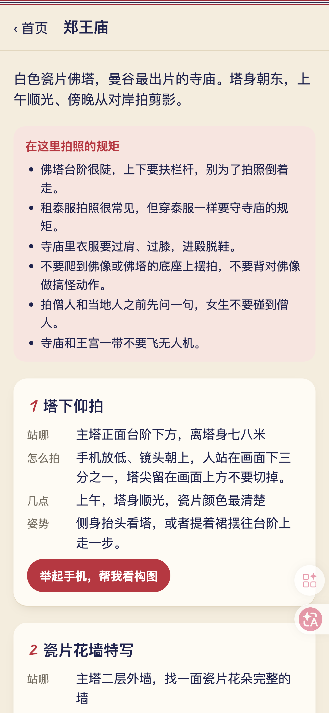
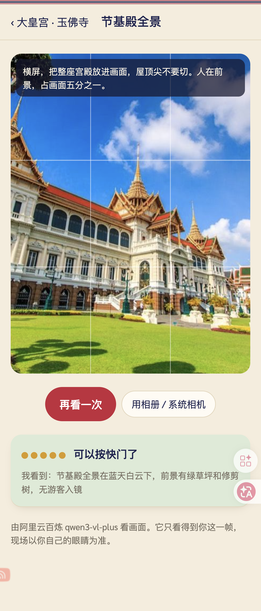
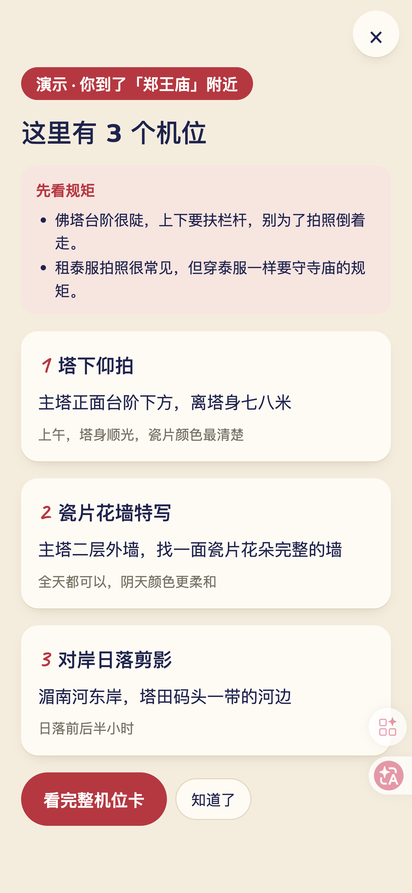
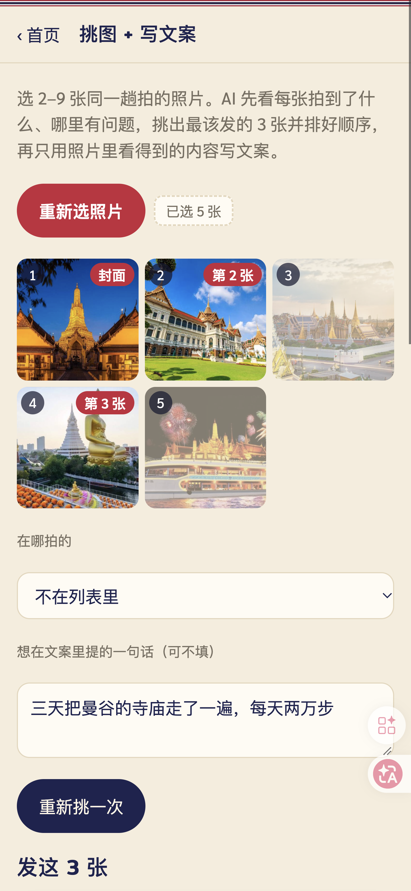
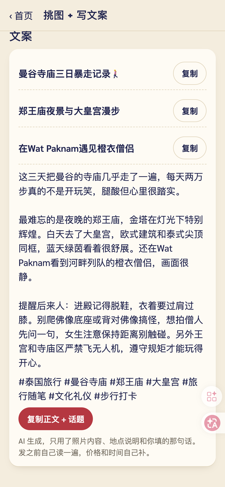
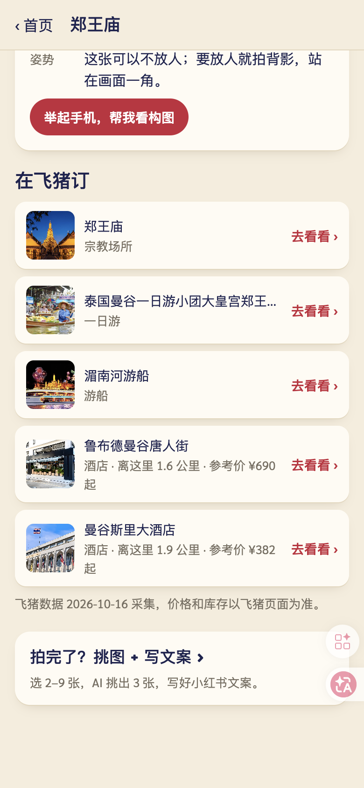

# 出片搭子：到了就知道怎么拍

2026 飞猪 AI 旅行创新大赛参赛作品。在线体验：https://bianzithai.pages.dev/pian （手机浏览器打开，免登录）

到了景点不知道怎么拍？出片搭子做四件事：

1. **机位卡**：曼谷 6 个地点、18 个机位，写清楚站哪、怎么拍、几点光线好，以及在这里拍照的规矩。
2. **举起手机看构图**：阿里云百炼 `qwen3-vl-plus` 看当前取景画面，对照机位卡给出具体动作（往哪走、手机抬高还是放低）。
3. **挑图 + 写文案**：`qwen3-vl-plus` 从 2–9 张里挑出 3 张并排序，`qwen3.8-flash` 只用照片内容和地点事实写小红书文案。
4. **走近提醒 + 飞猪商品**：走到机位附近主动弹出机位卡；每个地点挂飞猪的门票、游船和附近酒店。

完整的参赛说明见 [SUBMISSION.md](SUBMISSION.md)。

## 结构

```
pian.html                    单页应用（原生 HTML/JS，无构建）
data/pian/spots.json         机位卡和拍照规矩（作者整理）
functions/api/pian/look.js   POST /api/pian/look  看构图
functions/api/pian/pick.js   POST /api/pian/pick  挑图 + 文案
functions/_lib/pian.js       两个接口共用的小工具
functions/_lib/bailian.js    百炼调用、限流（与「安心游泰国」共用）
```

```
手机浏览器 ──相机一帧 / 2–9 张照片──▶ Cloudflare Pages Functions ──▶ 阿里云百炼
   ▲                                      │  qwen3-vl-plus（看图）
   │  机位卡 spots.json                    │  qwen3.8-flash（写文案）
   │  飞猪快照（景点 / 门票 / 酒店）        ▼
   └──────────── JSON：分数、动作、挑图顺序、文案 ◀────────────
```

## 自己部署

1. 部署到 Cloudflare Pages，根目录就是本仓库。
2. 在 Pages 的密钥里设置 `DASHSCOPE_API_KEY`（百炼 API Key）和 `DASHSCOPE_BASE`（百炼地址，例如 `https://dashscope.aliyuncs.com`）。
3. 可选：绑定一个 D1 数据库到 `DB`，建表 `trip_calls (ts INTEGER, ip TEXT, k TEXT)` 用于按 IP 限流；不绑定也能跑。
4. 飞猪商品链接读取 `data/trip/bkk.json`（飞猪 flyai 推广者接口采集的快照，不在本仓库里）；没有这个文件时机位卡和 AI 功能照常可用，只是不显示商品。

## 截图

| 首页 | 机位卡 | 看构图 | 到达提醒 |
|---|---|---|---|
|  |  |  |  |

| 挑图 | 文案 | 飞猪商品 |
|---|---|---|
|  |  |  |

截图为线上真实运行结果；「看构图」和「挑图」的输入图片用的是飞猪景点图片，不是现场实拍。

## 说明

- 机位和规矩是作者在曼谷整理的经验，不写开放时间和票价，以现场为准。
- 照片发给百炼处理后不保存；定位只在手机上计算。
