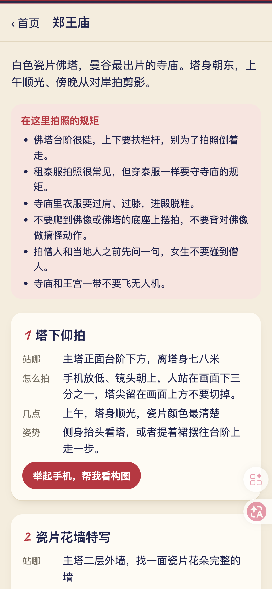
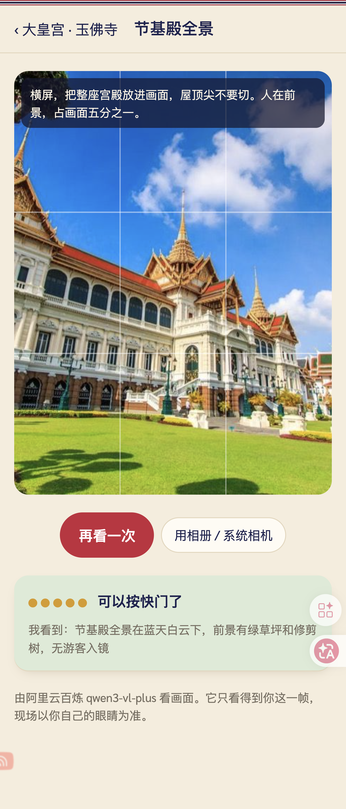
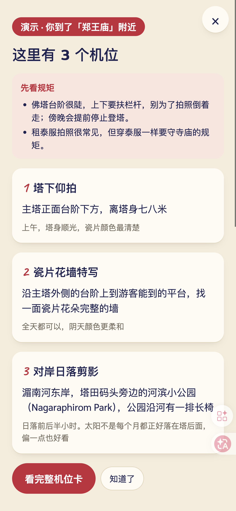
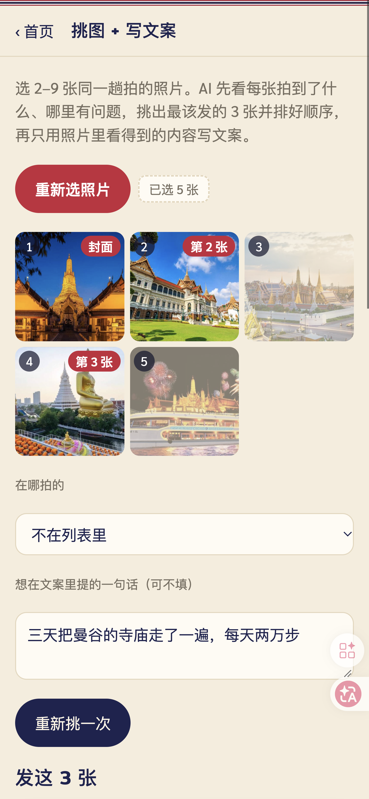
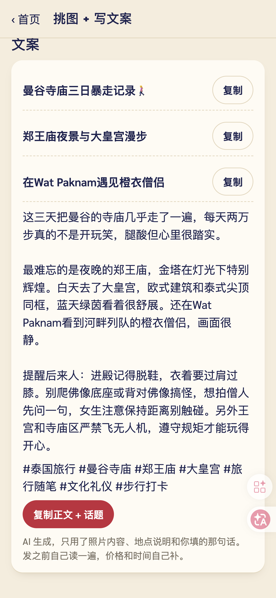
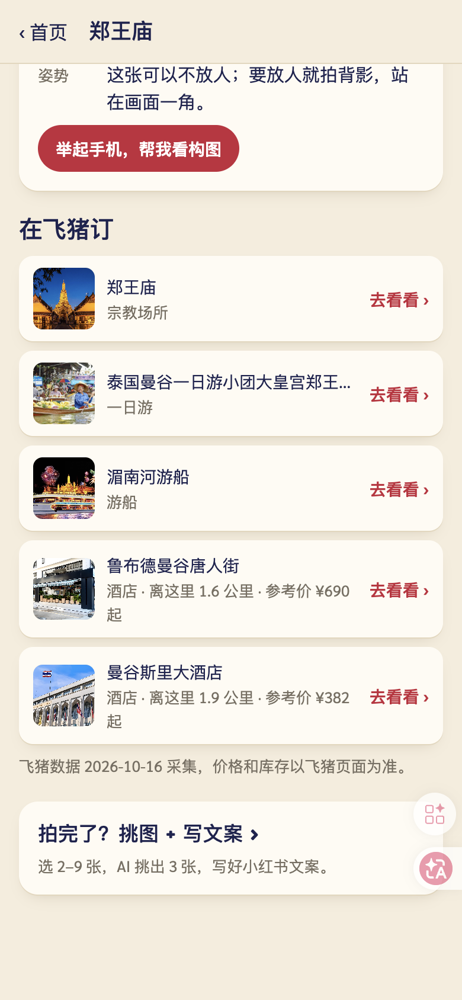

## 参赛项目名称

**出片搭子**：到了就知道怎么拍

在线体验：https://bianzithai.pages.dev/pian （手机浏览器打开，免登录）

## 团队 / 作者与奖品领取人

- 团队名称：辫子
- 主要提交人 GitHub ID（仅 1 位，必填）：@bianzigege
- 其他成员（可选，仅用于署名）：无
- 说明：同一作者另有一件参赛作品 #184「开口泰·安心游泰国」。两件是不同场景的独立作品；按大赛规则，同一团队最多登记 1 份奖品。

## 旅行场景与目标用户

**场景**：人已经站在景点里了，举着手机不知道怎么拍；回到酒店，几百张照片不知道发哪几张，文案也写不出来。

**目标用户**：出门旅行要发小红书、朋友圈的普通游客。不是摄影爱好者，用的就是手机。第一版只做曼谷。

**要解决的问题**：

现在的旅行工具大多管到「去哪、住哪、怎么走」就结束了。可是对很多人来说，一趟旅行算不算值，要看有没有拍到几张满意的照片。这件事有三个卡点：

1. **去之前不知道拍什么**。攻略里的「机位」是别人修过的成片，到了现场找不到站位，也不知道几点光线对。
2. **到了现场没人教**。同行的人也不会拍，拍完一看：塔尖切掉了，地平线歪了，人站在正中间。
3. **拍完不会挑、不会写**。相似的照片十几张，选不出来；文案憋半小时。

还有一件容易被忽略的事：**在泰国的寺庙里，有些照片不能拍，有些姿势不能摆**。玉佛殿里禁止拍照，不能爬到佛塔底座上，不能背对佛像搞怪。游客常常是发出去被人指出来才知道。

我在曼谷生活，自己拍探店视频，这些地方去过很多次。出片搭子把「本地人知道的机位和规矩」和「AI 看着画面给建议」放在一起。

## 我做了什么

1. **机位卡：去之前就知道拍哪几张**
   曼谷 6 个地点（郑王庙、大皇宫·玉佛寺、卧佛寺、金山寺、水门寺、湄南河夜游），每处 3 张机位卡。每张写清楚：站哪、怎么拍、几点光线好、什么姿势。每个地点先列出「在这里拍照的规矩」。机位和规矩由作者整理，并对照近期游记核对过站位；不写开放时间和票价。

2. **举起手机看构图（多模态）**
   选一张机位卡，举起手机，按「帮我看看」。百炼视觉模型看当前这一帧，对照这张机位卡想要的画面，给 1–5 分和最多 3 条具体动作，例如「往右移 3 步，避开左上角的树冠」「手机放低一点，让屋顶尖完整入画」。说的是「蹲低」「放到右上角」这种话，不讲摄影术语。画面里如果有不合规矩的情况（着装、爬上底座、禁拍区域），会单独提醒。
   - **连续看**：按一下，取景画面保持实时，每隔几秒自动看一次，最多 6 次，画面合适了就停下来说「可以按快门了」。
   - **念给我听**：举着手机时没人低头看小字，所以最要紧的那一条建议会用语音念出来（可关）。
   - 镜头没对着景（对着菜单、被手挡住、全黑）时会直接说「镜头没对着景」，不会硬给构图建议。

3. **挑图 + 写文案（多模态）**
   选 2–9 张照片。百炼视觉模型先说每张拍到了什么、问题在哪（糊、歪、主体被切、路人抢镜），挑出最该发的 3 张并排好顺序，说明为什么这张当封面。太暗、太糊或不是旅行照片的不会被选中，能发的不到 2 张时会直接告诉你。然后文本模型只用「照片里看到的内容 + 地点说明 + 用户自己填的一句话」写 3 个标题、一段正文和话题标签，一键复制。不编价格、开放时间和没发生过的经历。

4. **走到机位附近主动提醒（空间感知 + 主动服务）**
   开启提醒后，走到这 6 个地点附近，页面主动弹出这里的机位和规矩，同一处 6 小时内不重复。不在泰国可以点「演示：模拟走到郑王庙」。首页的地点会按离你的远近排序。

5. **飞猪真实商品**
   每个地点下面挂飞猪上的景点、门票或游船，以及离这里最近的两家酒店和参考价，点击跳转飞猪。链接由作者的飞猪推广者身份生成。

### 商业前景

- 「出片」是年轻游客的高频需求，而且发生在行中，这是现有旅行产品覆盖最少的一段。
- 对飞猪：用户在现场打开页面时，正是需要门票、游船、旅拍、附近酒店的时候；机位卡天然能带商品（「这个机位在游船上」→ 游船票）。
- 可复制：换一座城市，只需要换一份机位数据；规矩和提示词的结构不变。

## 百炼使用说明（必填）

百炼位于**运行时链路**，是「看构图」和「挑图写文案」两个核心功能的全部实现。

- **百炼能力 / 模型**：
  - `qwen3-vl-plus`：看取景画面给构图建议；看多张照片，描述、打分、排序
  - `qwen3.8-flash`：根据照片描述和地点事实写小红书文案（JSON 输出，关闭思考模式）
- **调用方式**：百炼 API，OpenAI 兼容接口 `/compatible-mode/v1/chat/completions`。由 Cloudflare Pages Functions 在服务端调用，API Key 放在服务端密钥里，浏览器拿不到。
- **使用环节与输入输出**：
  - 看构图：一帧取景画面（JPEG）+ 这张机位卡的站位、拍法、姿势 + 这个地点的规矩 →（qwen3-vl-plus）画面里有什么、1–5 分、最多 3 条动作、姿势建议、规矩提醒（JSON）
  - 挑图：2–9 张照片 →（qwen3-vl-plus）每张拍到什么、好在哪、问题在哪、分数，以及发布顺序和封面理由（JSON）→ 选中照片的描述 + 地点说明 + 规矩 + 用户补充的一句话 →（qwen3.8-flash）3 个标题、正文、话题标签（JSON）
- **Skill 名称**：飞猪 flyai（`@fly-ai/flyai-cli`，官方 CLI + 推广者正式 API Key，采集曼谷的景点、门票、游船和酒店）
- **其他工具 / 技术栈**：原生 HTML/JS 单页、浏览器相机（getUserMedia）、Geolocation 地理围栏、Cloudflare Pages + Pages Functions + D1（按 IP 限流）

## 效果展示

**演示视频（64 秒，竖屏，线上真实操作录屏）**：[点击下载 / 播放](https://github.com/bianzigege/chupian-dazi/releases/download/v1.0/chupian-demo.mp4)

<table>
<tr>
<td align="center" width="25%"> 首页：6 个出片地点</td>
<td align="center" width="25%"> 机位卡：站哪、怎么拍、几点、规矩</td>
<td align="center" width="25%"> 看构图：AI 看着画面说怎么挪</td>
<td align="center" width="25%"> 走到附近主动提醒（演示）</td>
</tr>
<tr>
<td align="center" width="25%"> 挑图：5 张里选 3 张，标出封面</td>
<td align="center" width="25%"> 文案：标题、正文、话题，一键复制</td>
<td align="center" width="25%"> 飞猪真实商品和附近酒店</td>
<td></td>
</tr>
</table>

**截图和视频说明**：以上截图和演示视频是 2026-11-20 在线上环境的真实运行结果，AI 的建议和文案都是百炼现场返回的。其中「看构图」和「挑图」用的输入图片是飞猪的景点图片，用来代替手机取景画面和游客照片，不是现场实拍。视频里「连续看」的相机画面也是用这张示例图片模拟的（先取景偏低、切掉塔尖，再移到完整构图），AI 两次给出的建议是现场返回的。

## 项目链接与复现方式

### 最终版本与体验条件

- **最终版本**：线上 Demo https://bianzithai.pages.dev/pian ，代码仓库 main 分支与线上一致。
- **登录**：不需要注册和登录。
- **额度**：百炼调用费用由作者承担，评委不需要自备 API Key。为防滥用，每个 IP 每小时限：看构图 60 次、挑图写文案 12 次。
- **设备**：建议手机浏览器（Safari / Chrome），需要允许相机；位置提醒需要允许定位。微信内置浏览器里相机和定位可能用不了。**没有相机、手边没有照片也能完整体验**：看构图页有「没在现场？用示例图试试」，挑图页有「手边没照片？用 5 张示例图试试」。

### 入口与体验步骤

- **在线 Demo**：https://bianzithai.pages.dev/pian
  - 首页点任意地点，看 3 张机位卡和规矩
  - 机位卡上点「举起手机，帮我看构图」，对着任意画面按「帮我看看」（约 4–8 秒），或按「连续看：边挪边看」；不在现场就点「没在现场？用示例图试试」
  - 首页点「已经拍完了？挑图 + 写文案」，选 2–9 张照片（约 20–30 秒）；手边没照片就点「用 5 张示例图试试」
  - 不在泰国：首页点「演示：模拟走到郑王庙」看到达提醒
- **代码仓库**：https://github.com/bianzigege/chupian-dazi

### 哪些是实时的，哪些是快照，哪些是模拟

- **实时调用百炼**：看构图、挑图、写文案。每次都是现场请求模型，结果每次可能不同。
- **作者整理的固定内容**：18 张机位卡和拍照规矩，是作者在曼谷的经验整理，不是 AI 生成，也不是实时数据。
- **飞猪数据是快照**：景点、门票、游船、酒店是 2026-10-16 用飞猪 flyai 推广者正式接口采集的，页面上标有采集日期。价格是当时的参考价，以跳转后的飞猪页面为准。
- **模拟演示**：「演示：模拟走到郑王庙」是模拟定位；人在曼谷并开启定位时，提醒由真实位置触发。
- **示例图片**：「用示例图试试」用的是飞猪的景点图片，页面上有标注；它只是替代输入，AI 的建议、挑图和文案仍然是针对这些图片现场生成的。
- **隐私**：照片发给百炼处理后不保存；定位只在手机上计算；服务器只记 IP 和调用次数用于限流。

## 踩坑记录（可选）

1. **视觉模型会被背景资料带着「脑补」画面**：把机位卡的拍法给了模型之后，拿一张菜单去试，模型回答「主塔正面台阶下，塔尖完整」，还打了 5 分——它在复述机位卡，没在看图。改成要求模型先只看图写出画面里有什么，再对照机位卡；并加一个判断「镜头是不是对着景」，不是就直接 1 分。同样的问题也出现在挑图：告诉模型「地点是郑王庙」，它会把大皇宫的照片也说成郑王庙，所以挑图这一步不再告诉模型地点。

2. **视觉模型给的建议太虚**：一开始只给画面，得到的是「构图不错，可以尝试三分法」。把这张机位卡的站位、拍法一起给模型，并要求每条建议必须是具体动作（往哪走几步、手机抬高还是放低、把什么放到画面哪里），输出才能照着做。
3. **文案会编**：只给照片让模型写小红书，会出现编造的价格、开放时间和「排队两小时」。改成两步：视觉模型只负责说照片里有什么，文本模型只能用这些描述加上地点说明和用户自己的一句话。页面上仍然提示「发之前自己读一遍」，因为这个约束不是百分之百牢靠。
4. **满分还给三条修改意见**：模型给 5 分的同时列 3 条「再调一下」。在提示词里限定满分时最多 1 条，页面上把 4 分以上的建议标成「想更好还可以」。
5. **没有人也给姿势建议**：画面里没人时模型照样写姿势。提示词里写明「画面里没有人必须是空」。
6. **全黑的照片被选进前三**：只传全黑图和菜单时，模型照样排出「前 3 张」并写了一篇关于黑屏的文案。现在分数过低的照片在代码里直接排除，能发的不到 2 张就返回提示，不写文案。
7. **手机拍的照片太大**：12MP 原图直接传会超时。看构图缩到长边 960 像素，挑图每张缩到 768 像素，每张一百多 KB，9 张一起传也不会超时。
